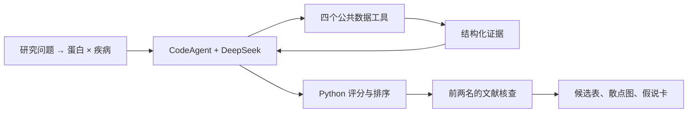

# BioBlindSpot Lite

- 围绕一个指定蛋白和疾病，自动筛选值得优先阅读的关联蛋白，核查已有研究，并生成带来源的研究问题草稿。

默认案例为人类 **SLC7A11 × 三阴性乳腺癌（TNBC）**，也可以指定其他蛋白与疾病。程序筛选实验通道评分较高、PubMed 关注度较低的关联蛋白，核查文献，并生成一张待验证假说卡。

运行环境为 `bio_agent` conda 环境。代码使用单个 smolagents CodeAgent 和 DeepSeek；公共证据来自 STRING、PubMed、UniProt 和 PMC。

## 运行

```bash
cd /home/pengxl/Projects/workspace/bio_agent
conda run -n bio_agent python -m pip install -r requirements.txt
```

在项目根目录的 `.env` 中配置：

```dotenv
DEEPSEEK_API_KEY=你的密钥
DEEPSEEK_BASE_URL=https://api.deepseek.com
DEEPSEEK_MODEL=deepseek-flash
```

模型名以当前账户可用模型为准。`.env` 已加入 `.gitignore`。

```bash
# 完整 Agent：终端输入一句研究问题；直接回车使用默认案例
conda run --no-capture-output -n bio_agent python bio_agent.py

# 用自然语言指定蛋白与疾病
conda run --no-capture-output -n bio_agent python bio_agent.py \
  --task "围绕 GPX4 在胰腺癌中寻找低关注关联蛋白，核查文献并提出待验证假说"

# 直接指定参数
conda run --no-capture-output -n bio_agent python bio_agent.py --gene GPX4 --disease "胰腺癌"

# 数据基线：固定流程调用真实 API，输出评分和原始补检证据
conda run --no-capture-output -n bio_agent python bio_agent.py --data-only

# 使用已有公共数据缓存重放数据基线
conda run --no-capture-output -n bio_agent python bio_agent.py --data-only --offline

# 必要的离线检查
conda run -n bio_agent python -m unittest -v test_workflow
```

默认每次写入 `outputs/时间戳/`。用 `--output 新目录` 指定位置。公共 API 的原始响应保存在 `.cache/`，相同请求复用缓存。`--offline` 要求查询已经缓存；Agent 模式仍会调用 DeepSeek。

录屏时可先执行 `conda activate bio_agent`，然后运行 `python bio_agent.py`，输入一句包含蛋白和疾病的研究问题。终端依次展示任务输入、当前检索进度、候选排名、证据核查、假说卡和文件位置。建议终端宽度设为 100–120 列。Agent 生成的代码和调试输出写入 `run.log`，完整执行步骤写入 `agent_trace.json`。

`--task` 由 DeepSeek 识别人类基因符号及英文疾病名，需要 API 密钥。`--gene` 与 `--disease` 必须同时提供；疾病支持 TNBC、三阴性乳腺癌、胰腺癌及英文疾病名称。其他中文疾病通过自然语言输入。TNBC 和胰腺癌使用预设查询式，其他疾病使用英文名称的 Title/Abstract 精确短语检索；自然语言解析得到上位疾病时会补检该范围。实际查询式保存在 `result.json.input` 和报告中。

无交互终端且未指定输入时使用默认案例。纯数据模式若要完全不调用模型，请使用 `--gene/--disease` 指定输入。

## 输入输出流

输入是一句研究问题，或 `--gene/--disease` 参数；解析后得到基因、疾病、PubMed 查询范围和 PMC 查询范围。物种为人类（`species=9606`），DeepSeek 配置来自 `.env`。运行后会依次经过以下阶段：

| 阶段 | 输入 | 操作 | 输出及下一步用途 |
|---|---|---|---|
| 1. 获取关联蛋白 | 输入的核心蛋白、人类物种编号 | 查询 STRING 当前版本，使用其版本地址取得最多 20 个综合分数 ≥0.7 的邻居 | 候选基因、STRING ID、实验/综合/共表达/文本挖掘评分，以及每个基因的 PubMed 查询式 |
| 2. 统一检索 | 每个候选的标准基因名查询式 | PubMed ESearch 统计命中数 | `pubmed_count`、实际查询翻译、检索提示；失败项的计数为 `null` |
| 3. 计算与排序 | 实验评分、PubMed 命中数 | CodeAgent 编写 Python 循环计算分数；程序根据工具记录复核 | 全部候选排名；实验评分 ≥0.7 且检索成功的前两名进入核查 |
| 4. 补充检索 | 前两名、所选疾病及补检范围 | UniProt 查功能与别名；PubMed 补检并读取摘要；PMC 检索并提取正文及表格片段 | 带 PMID、PMCID、UniProt ID 的证据；补检统计单列，初筛分数保持原口径 |
| 5. 证据判断 | 初筛表、摘要、全文片段、功能注释 | Agent 判断证据属于数据库关联、提及、相关性还是机制实验 | 每个候选的结论、关键证据、待核查问题；一张假说卡 |
| 6. 导出 | 经数值与引用来源检查的结果 | 保存表格、散点图、结果和运行轨迹 | 下表中的文件 |



| 文件 | 内容 |
|---|---|
| `candidates.csv` | 全部候选、实验分数、初筛命中数、BlindSpot Score、入围标记、查询式和来源链接 |
| `blindspots.png` | 横轴 `log10(PubMed count + 1)`，纵轴 STRING 实验评分；标注实验评分达标的候选 |
| `report.md` | 候选表、图、前两名的证据结论和假说卡；数据基线模式只包含统计说明 |
| `result.json` | 输入、模式、候选排名、核查结果、来源映射和完整工具调用结果 |
| `tool_calls.jsonl` | 每次调用的参数、结果、请求 URL、抓取时间和缓存信息 |
| `agent_trace.json` | Agent 生成的代码、观察和执行步骤；仅 Agent 模式生成 |
| `run.log` | Agent 的详细执行日志；运行失败时包含异常详情 |

`result.json.review` 的结构：

```text
reviews[]
  gene                候选基因
  assessment          核查结论
  evidence[]          source_id、kind、claim
  gap                 证据缺口
hypothesis
  gene                假说候选；证据不足时为 null
  statement           待验证假说
  prediction          可证伪预测
  validation          对照、干预、救援与观察指标
  limitations         当前证据的具体缺口
  source_ids[]        事实依据的来源 ID
```

## 评分与核查

```text
BlindSpot Score = experimental_score / (1 + log10(pubmed_count + 1))
```

`experimental_score` 使用 STRING 的 `escore`。初筛采用标准基因名的 Title/Abstract 检索，疾病部分使用当前任务的查询式；TNBC 案例合并 MeSH、全称和缩写。`low_attention=true` 表示实验评分 ≥0.7 且初筛命中 ≤2，作为阅读线索。

前两名均接受证据核查；假说候选只从满足 `low_attention` 的行中选择，其余作为既有研究参照。假说卡的验证思路限制为四组以内的细胞实验及两到三个观察指标。

别名补检由 Agent 根据 UniProt 返回值选择；数据基线使用返回的全部别名，命中内容仍需消歧。PubMed 每次最多读取 3 篇摘要，PMC 每次最多读取 3 篇全文的基因相关片段。全文提及和基因机制实验在报告中分别标记。PMC 会提取正文及 `floats-group` 表格，并排除参考文献中的单纯共现。

程序复核 Agent 的数值结果，并要求引用 ID 出现在实际工具输出中。证据与结论的语义对应关系可通过 `result.json` 中的摘要、上下文片段和原文链接复核。模型核查保留了引用出处，但引用有效本身不证明结论正确。

## 案例评估

对同一组真实数据比较数据基线与 Agent 输出：SLC25A25 可能在 PubMed 标题/摘要检索中零命中，而 PMC 全文已有提及。检查 Agent 是否区分“初筛零命中”“表达数据或相关性研究”“机制验证”，并据此调整假说。

本次完整运行的结果在 `outputs/agent-demo/`，数据基线在 `outputs/data-baseline/`。两者的 12 个候选及评分一致，4 个候选的实验评分达标，深入核查对象为 SLC25A25 和 OTUB1。Agent 识别了 SLC25A25 在 TNBC 中已有的表达关联，并为它生成假说卡。

假说卡保留模型原始输出。人工核查发现：模型预测敲低 SLC25A25 会增强铁死亡，而所引 [PMC12489925](https://pmc.ncbi.nlm.nih.gov/articles/PMC12489925/) 在非 TNBC 模型中观察到敲低后的部分缓解；这一方向差异尚需解释。运行验证覆盖数据处理、来源追溯及文件导出，生物学结论仍需逐条核对。

测试覆盖零命中与请求失败的区别、实验通道评分、PMC 正文和浮动表格解析、基因名称边界，以及虚构引用的拒绝。运行日志保留实际检索时间；复用缓存时沿用原始抓取时间。

## 代码与数据接口

- `bio_tools.py`：四个 `@tool`、HTTP 限速与重试、原始响应缓存、文献解析。
- `bio_agent.py`：两阶段 Agent、数据基线、结果复核和导出。
- `bio_input.py`：自然语言解析、疾病查询范围。
- `bio_console.py`：终端进度、候选表、证据及假说卡。
- `test_workflow.py`：标准库 unittest 检查。

接口说明：[STRING API](https://string-db.org/help/api/)、[NCBI E-utilities](https://www.ncbi.nlm.nih.gov/books/NBK25501/)、[UniProt REST API](https://www.uniprot.org/help/api_queries)、[DeepSeek API](https://api-docs.deepseek.com/)。
